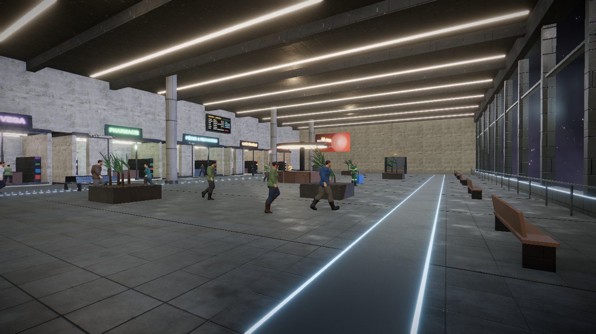

# Sillage — Hangar 07, station Halden-7

Jeu jouable dans le navigateur (Three.js + Vite) : un grand hangar d'atterrissage de station
orbitale, relié par un sas à une galerie marchande, avec une baie donnant sur une planète.
Univers original, ressources CC0 ou créées pour le projet (voir [CREDITS.md](CREDITS.md)).


| | |
|---|---|
|  |  |
|  |  |

## Lancer le jeu

Prérequis : Node.js 20 ou plus récent.

```bash
npm install
npm run dev          # http://localhost:5173 (et l'adresse réseau locale pour tester sur téléphone)
```

Version de production :

```bash
npm run build        # génère dist/
npm run preview      # sert dist/ sur http://localhost:4173
```

Pour tester sur un téléphone pendant le développement : `npm run dev`, puis ouvrir l'adresse
« Network » affichée par Vite depuis le téléphone (même réseau Wi-Fi).

## Commandes

| Action | Clavier / souris | Tactile |
|---|---|---|
| Se déplacer | ZQSD (AZERTY) ou WASD (QWERTY), flèches | joystick gauche |
| Regarder | souris (clic pour capturer le pointeur) | glisser sur la droite de l'écran |
| Courir | Maj | bouton COURIR (bascule) |
| Vue 1re / 3e personne | V | bouton VUE |
| Interagir (siège pilote, café, kiosque) | E | bouton E |
| Inventaire (personnage, Héron, sac) | I | bouton SAC |
| Décoller (assis aux commandes) / atterrir près de l'aire 02 | Espace / L | bouton ⏻ |
| Vol : poussée, monter / descendre, roulis, postcombustion | ZQSD, Espace / C, Q / E, Maj | joystick, ▲ ▼ |
| Tirer (canons, ou laser de minage en mode minage) | clic gauche / X | bouton TIR (maintenir) |
| Missile (après 3 s de verrouillage) / cible suivante | R / T | bouton MSL |
| Mode minage | M | bouton MIN |
| À pied sur un avant-poste : descendre armé / dégainer, recharger, changer d'arme, soin | G, R, T, H | ARME, MSL, —, SOIN |
| Menu / qualité | Échap | bouton ≡ |

Le vaisseau du joueur (Héron, aire 02) s'ouvre par la rampe arrière : on monte à bord sans
chargement, on traverse la soute, on gravit les marches du cockpit et on s'assoit aux commandes (E).

## Missions de fret

Au **quai de fret** (zone jaune à gauche de la rampe du Héron), le **terminal des contrats** propose des offres :
- **Livraison** : les caisses apparaissent sur le quai ; on les porte (E) jusque dans la soute, où elles sont arrimées
  automatiquement sur la grille, puis on vole jusqu'à l'avant-poste et on livre (E une fois posé).
- **Collecte** : on se pose à l'avant-poste, on charge (E), on revient et on dépose chaque caisse sur le quai.
- **Conteneur** : la manutention charge un conteneur dans la soute (4 rangées libres nécessaires).

Trois avant-postes en orbite : **Relais Corvin** (dépôt), **Plateforme Ardent-3** (mine et raffinerie),
**Station agricole Lys** (serres). Un repère à l'écran indique la destination et la distance ; on s'y pose avec L
(ou ⏻) quand on est à moins de 22 m au-dessus de l'aire. Paiement à la livraison ; abandon : pénalité de 10 %.
Code : `src/game/cargo.js`, `src/game/missions.js`, `src/world/outposts.js`.

## Minage et raffinage

1. Achetez un **laser de minage** à l'Équipement naval (ML-1 « Pic » ou ML-2 « Foreuse ») : il s'installe sous le nez du Héron.
2. Volez jusqu'au **champ d'astéroïdes** (Ceinture d'Ardent, repère à l'écran), puis **M** (bouton MIN) : mode minage,
   vitesse réduite, caméra relevée. Le panneau affiche la composition de la roche visée (fer, cuivre, titane,
   corindon, aurélite, part inerte), sa résistance et son instabilité.
3. **Clic gauche / X** (bouton LASER maintenu) : la charge monte ; gardez-la dans la **zone verte** pendant 3 s pour
   fracturer la roche ; au-delà de la zone rouge, surcharge : la roche est pulvérisée et perdue.
4. Visez les **fragments** et maintenez le laser à moins de 90 m pour extraire le minerai vers le bac (32 SCU ; la part inerte est rejetée).
5. Posez-vous à la **Plateforme Ardent-3** : *E — Opérations à quai* → **Raffinerie** (vente brute immédiate, ou
   raffinage Rapide / Standard / Précis : durée, rendement et frais différents) puis **Marché** (vente au cours du jour).
Code : `src/game/mining.js`.

## Combat spatial

À plus de 1,5 km de Halden-7, l'espace n'est plus surveillé : des chasseurs pirates interceptent le
Héron pendant les trajets et dans la Ceinture d'Ardent (vagues plus grosses quand la soute est pleine
ou en plein minage). Deux modèles : l'Écorcheur, léger et vif, et le Charognard, plus lourd et
mieux protégé. Ils attaquent en passes successives (approche en tire-bouchon, tir anticipé, dégagement)
et décrochent si vous revenez dans la zone protégée de la station (1,1 km, armes verrouillées).

- **Armes du Héron** : celles installées à l'Équipement naval tirent depuis leur emplacement réel.
  Laser (énergie, illimité), balistique (600 obus, 40 % des dégâts traversent les boucliers),
  lance-missiles (4 missiles à guidage, verrouillage en gardant la cible 3 s dans l'axe).
  Un cercle jaune indique le point de tir anticipé ; les tirs proches de l'axe sont corrigés vers lui.
- **Tourelle dorsale** : servie automatiquement par l'artilleur recruté s'il est à bord.
- **Boucliers et coque** : le bouclier encaisse d'abord et se recharge après quelques secondes sans
  impact (S1 : 2 400, S2 : 5 200). La coque est conservée d'un vol à l'autre ; réparations et réarmement
  sont facturés à l'atterrissage.
- **Primes** : chaque pirate abattu rapporte 900 à 2 800 ¤.
- **Destruction** : capsule de survie, Héron remplacé à l'aire 02, franchise d'assurance
  (2 500 ¤ + 5 % des crédits) et perte du minerai.
- **Interface** : barres bouclier / coque, armement, cadre de cible (bouclier, coque, distance),
  repères des autres hostiles, radar de 2,5 km (station en vert).

## Combat à pied (avant-postes)

Les avant-postes ont désormais un pont de débarquement entre l'aire et la tour, avec des caisses
qui servent de couverture. Le Héron s'y pose rampe face au pont.

- **Raids** : à l'atterrissage sur un avant-poste, un raid pirate peut être en cours (3 chances sur 10,
  ou à coup sûr avec un contrat « Sécurité » du terminal des contrats). Les pirates sortent de la tour,
  prennent position derrière les caisses, tirent en rafales, s'accroupissent et rechargent.
- **Descendre armé** : posé sur l'avant-poste, **G** (bouton ARME) fait descendre par la rampe ;
  l'arme est dégainée automatiquement pendant un raid. **E** à la rampe pour remonter à bord.
- **Armes personnelles** : celles de l'Armurerie Kestrel (dégâts, cadence, portée, chargeur, dispersion
  propres à chaque arme ; tir réel au centre de l'écran, tête ×2). **R** recharger, **T** passer de
  l'arme principale à l'arme de poing, **H** stylo médical (+55 santé). Armes interdites dans la station.
- **Gardes** : les gardes de l'équipage à bord descendent avec vous, avec l'arme et l'armure que vous
  leur avez achetées, prennent les caisses côté vaisseau et combattent. Un garde blessé reste à terre
  jusqu'à la fin du raid.
- **Armure** : réduit les dégâts reçus (légère 20 %, moyenne 40 %, lourde 65 %).
- **Récompenses** : 420 à 720 ¤ par pirate, puis le contrat de sécurité ou une prime de 1 500 ¤.
- **À terre** : évacuation à bord, soins d'urgence (1 200 ¤), le raid échoue (le contrat reste ouvert).

## Cour des Saveurs (restauration)

Sur le pont habitat, le couloir nord du hall des ascenseurs mène à une grande salle de restauration
(70 × 40 m, verrière sur l'espace, fontaine holographique, arbres, tables et tables hautes). Dix restaurants,
chacun avec son enseigne, son menu lumineux, sa cuisine équipée et ses horaires : Dragon de Jade (chinois),
Cantina Sol (mexicain), Fournil d'Orbite (boulangerie), Taqueria Cometa (tacos), Masala Station (indien),
Sushi Orbital, Grill 66 (burgers), Pizzeria Vesuvio, Café Nébula, Phở Lune Rousse (vietnamien).
E au comptoir : la carte du restaurant (chaque plat rend un peu de santé). Les cuisiniers passent du fourneau
au comptoir, des clients mangent attablés, d'autres commandent puis mangent debout. Borne-plan à l'entrée.

Détail : plats modélisés (bols de phở et de ramen, makis et nigiris sur tapis roulant, pizzas, burgers, tacos,
croissants et baguettes, raviolis vapeur, currys), woks, marmites, paniers vapeur, canards laqués, four à pizza,
frigos vitrés garnis, rails d'ustensiles, menus illustrés, chevalets ardoise, plateaux servis sur les tables,
condiments et serviettes, stations de tri, affiches, bannières suspendues, gaines de ventilation, robot de
nettoyage, vapeur et flammes en cuisine, ambiance sonore (brouhaha, friture, vaisselle). Les figurants du pont
sont solides (on ne les traverse plus). Performances : figurants du pont sans ombre portée, animation figée
au-delà de 38 m, vaisselle fusionnée en géométrie statique.

Mobilier de station : sièges coque en composite sur pied pivotant, tables à liseré lumineux, suspensions annulaires
à LED, banquettes, bacs hydroponiques éclairés, sol en résine polie à panneaux. Aliments et plantes photoscannés
(Poly Haven, CC0) : croissants, gâteaux, pains à burger, agrumes, avocats, oignons, gingembre, fruits, bouteilles, cagettes.
Les plats cuisinés ont des textures alimentaires (croûte dorée, fromage gratiné, riz, saumon, bouillon, curry…).

**Vie des clients** : ils arrivent de la galerie par l'**ascenseur** (appel au palier, attente, embarquement, trajet,
sortie), font la queue au restaurant choisi, commandent, reçoivent leur plateau (plat selon la cuisine), le portent
à deux mains jusqu'à une place libre, s'assoient et **mangent** (bouchées portées à la bouche avec baguettes, fourchette,
cuillère ou à la main, mastication, pauses conversation ; le plat diminue), puis rapportent le plateau au point de tri
et redescendent à la galerie. Le cuisinier vient servir quand un client attend.

## Récit, conversations et mode analyse

- **Conversations cinématiques** : plan rapproché sur l'interlocuteur, bandes noires, sous-titres et voix de synthèse,
  roue de réponses (touches 1-6, clic ou toucher). Le ton des réponses est coloré : bleu (calme → Sérénité),
  rouge (ferme → Audace), gris (questions). Réputation affichée : Sérénité, Audace, réputation de Halden.
  Personnages : Joss Varrin (barman de La Comète : boissons, rumeurs, histoire de la station, tournée générale),
  Dr Salek (infirmerie), Mira Castel (conciergerie de La Couronne), Iréna Solvay (prévisionniste).
- **Récit principal « L'Équation de Halden »** : Iréna Solvay, devant sa sphère des tendances à La Couronne, a calculé
  que la station s'effondrera dans quarante ans. Porter son noyau de calcul à la station agricole Lys (se poser),
  protéger la diffusion contre trois intercepteurs (combat spatial, transmissions radio avec portrait), revenir
  et choisir : rendre la projection publique ou la confier au Conseil (30 000 ¤). Objectif affiché en haut à gauche.
- **Tout le monde parle** : E près de n'importe quelle personne (commerçants, mécaniciens, sécurité, voyageurs,
  cuisiniers, clients de la Cour, résidents, clientèle et personnel de La Couronne). Répliques selon le métier et le
  tempérament (aimable, pressé, méfiant, bavard), rumeurs qui mènent aux quêtes, avis qui changent selon vos choix.
  Chaque personne a dix répliques propres à son métier, une histoire personnelle stable (origine, situation, rêve,
  inquiétude, souvenir de la station, accordée au féminin ou au masculin), douze rumeurs et des salutations variées ;
  une réplique déjà entendue ne revient pas avant les autres. Aux comptoirs de la Cour des Saveurs, E ouvre la
  conversation avec le cuisinier, et « Je voudrais commander » ouvre la carte.
  La personne s'arrête, se tourne vers vous ; les clients attablés restent assis.
- **Voix** (réglage « Voix » du menu) : Auto (meilleure voix française du système, sinon voix stylisée), Système,
  Stylisée (voix inventée synthétisée, disponible sur tous les appareils), Sous-titres seuls.
- **Quêtes secondaires** : la liqueur d'aurélite de Joss (Plateforme Ardent-3, 2 500 ¤) ; le sérum du Dr Salek
  (station agricole Lys, 3 000 ¤ et une trousse de soins).
- **Chapitre 2 « Les Fils de la Brèche »** (après L'Équation de Halden) : la sphère révèle qu'un client de La Couronne
  finance les pirates. Le démasquer au salon du Zénith (mode analyse), puis choisir : le livrer à la sécurité, accepter
  son pot-de-vin (15 000 ¤) ou, avec assez de Sérénité, le convaincre de financer l'escorte des convois. Intercepter
  ensuite le cargo pirate (détruire ou aborder), faire son rapport (40 000 ¤).
- **Conséquences visibles** : l'écran d'actualités du hall et les conversations des habitants reflètent vos choix
  (courbe publiée ou confiée au Conseil, sort du financier).
- **Escadrille et briefing** : table holographique de l'escadrille dans le hangar (derrière le quai) avec la carte du
  secteur, la commandante et les ailiers Freux et Lynx. Briefing animé (route, menace, objectifs) au lancement des
  missions du récit, ou à la table. Engager un ailier : 2 000 ¤ la sortie ; les missions de combat du récit fournissent
  l'escadrille. En vol, les ailiers tiennent la formation, engagent les pirates, encaissent, décrochent quand ils
  sont trop touchés et parlent à la radio (portrait, voix).
- **Chapitre 3 « Le Signal de Merle »** : un signal monte des ruines de la station Merle (repère en vol). Tenir la
  position vingt secondes près de l'anneau brisé pour télécharger l'archive malgré les charognards, puis choisir à qui
  confier le plan du « Second Rivage » : la coopérative de Lys, le Conseil, ou toutes les fréquences (60 000 ¤ et une
  combinaison Halo).
- **Services des habitants** : certaines personnes demandent un coup de main (colis à livrer dans une station : se
  poser ; message à transmettre à Joss, au Dr Salek ou à Mira). Remerciement par radio, crédits, réputation.
- **Galerie néon** : panneaux publicitaires holographiques suspendus (animés, parasites), hologrammes tournants au-dessus
  de projecteurs, enseignes verticales en drapeau, tubes et liserés néon.
- **Mode analyse** (C, bouton SCAN) : filtre holographique et balayage, nom et fonction des personnes, points
  d'interaction, éléments remarquables à analyser (vaisseaux, yacht, sculpture, sphère, coupole, Cour des Saveurs)
  qui enrichissent le **codex** (K) : lieux, vaisseaux, culture, factions.

## La Couronne (étage de prestige)

Depuis le hall du pont habitat (coin nord-ouest), un **ascenseur panoramique en verre** monte 30 m plus haut jusqu'à
La Couronne : une salle circulaire de 44 m de diamètre sous une **coupole nervurée vitrée** (24 nervures nacrées éclairées,
anneaux dorés, oculus) qui s'ouvre sur l'espace et la planète. Sol en marbre noir veiné d'or avec incrustations,
bassin miroir et sculpture orbitale animée au centre.

- **Maison Élysée** (haute couture) : mannequins vivants sur podiums tournants, portants chromés, miroir en pied cerclé d'or,
  table d'exposition ; E au comptoir : ensembles de 15 800 à 32 000 ¤.
- **Nova Atelier** (combinaisons de haute technologie) : trois combinaisons exposées dans des vitrines cylindriques éclairées,
  établi holographique ; combinaisons « Halo », « Onyx », « Soleil » (68 000 à 145 000 ¤, protection 50 à 72 %).
- **Aérodyne** : yacht stellaire Série 9 sur plateau tournant, fiche technique holographique (48,5 M¤, sur commande).
- **Le Zénith** : salon-bar en onyx rétroéclairé, étagères de bouteilles, tabourets et banquettes en velours (120 ¤ la coupe).
- Personnel en activité : la conciergère saisit au terminal, la vendeuse d'Élysée retouche les portants et plie sur la table,
  le conseiller Nova contrôle les vitrines et l'établi, l'agent d'Aérodyne présente le yacht, le barman essuie le comptoir et
  va chercher des bouteilles, la sécurité fait sa ronde.
- Visiteurs fortunés : ils sortent de leur cabine du pont habitat, prennent l'ascenseur panoramique (appel, attente,
  trajet), font deux ou trois haltes (vitrines, comptoirs, yacht, bar, banquettes face à l'espace), puis redescendent.
- La coupole repose sur un calice nacré nervuré, bagué de lumière, prolongé par un fût jusqu'au toit du hall du pont
  habitat : la structure est visible depuis l'espace et par la verrière de la Cour des Saveurs.

## Personnages réalistes (Microsoft Rocketbox)

Les civils sont des personnages réalistes de la bibliothèque Microsoft Rocketbox (licence MIT) : vrais vêtements,
visages, cheveux, et quatre enfants. Ils remplacent les figurants de la galerie (voyageurs, clients), les clients de
la Cour des Saveurs, les résidents du pont habitat, la clientèle de La Couronne (tenues d'affaires) et toute la
population du Grand Dôme (le fermier porte la tenue de jardinier). Animations du jeu reciblées automatiquement
(os renommés à la conversion). Les rôles en uniforme ou en armure (sécurité, cuisiniers, pilotes, équipage, joueur)
gardent le corps paramétrable (tenues et armures en shader). Ferme et bassin : mouton, chèvres, cochon, poules, coq,
colverts réalistes, animés par le code (pattes en diagonale, broutage, picorage, flottaison). Sur téléphone : un
sous-ensemble de personnages et des textures allégées.

## Silhouettes, tenues et armures

- **Silhouettes affinées** : le corps de base (très musclé) est aminci le long de chaque os (torse, épaules, bras, jambes),
  sans changer la taille ni la longueur des membres ; un peu moins pour les silhouettes féminines.
- **Tenues ajustées** : tissu technique à quelques millimètres de la peau (fini l'effet doudoune), col et poignets resserrés.
- **Chaussures montantes** profilées et articulées (talon lié au pied, avant-pied aux orteils) : tige, empeigne arrondie,
  semelle fine.
- **Bords nets** : col, poignets et chevilles du vêtement découpés le long d'un contour, avec ourlet.
- **Mains détendues** : l'animation de repos serrait les poings ; les doigts sont ramenés vers une main naturelle
  (sauf en tenant une arme ou en mangeant).
- **Peau** : teinte moins orangée, teint propre à chaque personnage, légère rougeur, diffusion sous-cutanée approchée.
- **Armures de combinaison** : plaques fines générées à partir du corps, qui l'épousent et se déforment avec lui
  (plastron, dos, épaulières, bras, avant-bras, coudières, cuissards, genouillères, tibias selon le niveau), bords découpés
  nets avec épaisseur visible, joints creusés, chanfreins, liserés de couleur, voyants, usure ; module dorsal plat, col et
  ceinture fins. Trois niveaux : léger, moyen, lourd.

## Ascenseurs : priorité au joueur

L'appel du joueur est mis en file si la cabine roule et servi dès son arrivée : les figurants ne peuvent plus la
renvoyer ailleurs entre-temps (portes ouvertes quelques secondes pour laisser monter). Ils reprennent ensuite leur trafic.

## Architecture extérieure de la station

Vue de l'espace, Halden-7 forme un ensemble porteur cohérent :
- **Plateforme blindée** (8 m d'épaisseur) sous tout le pont habitat, à panneaux de blindage de tons variés, membrures,
  ceintures, hublots éclairés, chanfreins, coursive périphérique balisée et feux de navigation (bâbord rouge, tribord vert).
- **Coque pressurisée du pont habitat** autour du hall, des cabines et de la Cour des Saveurs, avec ouvertures alignées
  sur les vitrages intérieurs (baie du hall avec jardinières, vitrage ouest de la Cour, verrière en puits de lumière,
  passerelle du dôme, ascenseur panoramique) ; toit équipé : radiateurs, échangeurs thermiques, gaines, antennes,
  parabole, aires de maintenance marquées. Marquages peints « HALDEN-7 » et « PONT HABITAT · H-3 ».
- **Tour des ascenseurs** (cage vitrée éclairée), **pylônes** sur le toit de la galerie avec croisillons, **poutre-caisson**
  et **tube pressurisé** jusqu'au corps de la station.
- **Socle cylindrique du Grand Dôme** (hublots, coursive balisée), posé sur jambes de force et pylônes.
- **Pylônes d'approche** en treillis (membrures, cadres, croisillons) et bras d'amarrage en poutre Warren balisée,
  anneau d'amarrage nervuré.
- **Anneaux habités** à section profilée (plancher extérieur, flancs à deux rangées de hublots, verrière intérieure tournée
  vers le moyeu), 48 cloisons étanches, moyeux autour du corps, six rayons pressurisés par anneau (ascenseur vitré
  éclairé, colliers, treillis de reprise).
- **Corps cylindrique** : tôles de teintes différentes, ceintures sombres, hublots posés sur la coque, rampes de
  balisage, conduites longitudinales, mâts d'antennes ; ailes de radiateurs entre les anneaux ; à l'arrière, module
  réacteur, mât et quatre ailes solaires.

## Frégate Atalante (vaisseau à trois ponts, visitable)

Amarrée au sas 3 du hangar (côté tribord), reliée par une passerelle d'embarquement pressurisée. Coque de 110 m,
entièrement parcourable à pied, portes coulissantes automatiques, escalier entre les trois ponts :

- **Pont A (machines et logistique)** : sas d'entrée, vestiaire, atelier, armurerie, support vie, garage avec rover,
  soute à double hauteur (conteneurs, portique, passerelle), salle des machines et réacteur à l'arrière.
- **Pont B (équipage)** : infirmerie, quatre cabines (coin nuit, douche, lavabo), réfectoire et cuisine face aux
  baies, salon d'observation, coursive au-dessus de la soute.
- **Pont C (commandement)** : passerelle vitrée (pupitres, fauteuil de commandement, table holographique),
  cabine du capitaine, salle de briefing, salon panoramique.

Intérieurs meublés en détail (`src/world/shipdecor.js`) : lits superposés avec couettes, oreillers et échelle,
lit double et chevets, canapés et fauteuils capitonnés, tables basses, bureaux équipés (écran, clavier, lampe
articulée), armoires, bibliothèques garnies, salles d'eau (douche vitrée, WC suspendu, lavabo et miroir
rétroéclairé), lits médicalisés avec potence et moniteur, bar avec tabourets et mur de bouteilles rétroéclairé,
table de réunion à liseré lumineux. Les pièces de vie ont un faux plafond clair, des plafonniers, appliques et
lampadaires, des lambris bois et tissu, de la moquette, du parquet, des tapis, des plantes et des accessoires
photoscannés (Poly Haven, CC0).
Les grandes pièces sont redécoupées : chaque cabine a une chambre et un petit salon séparés par une cloison
lambrissée ; claustras en lames de bois et jardinières dans la cabine du capitaine et les deux salons ; tableaux
générés (abstraits et paysages). Zones techniques détaillées : rayonnages à palettes chargés, palettes de
cartons sanglés, transpalette, panneaux d'outils, tableaux de vannes et manomètres, bornes murales, mains
courantes et plinthes dans les coursives.
Les murs des salons, de la salle de briefing et du réfectoire sont habillés (lambris bois, tissu, passages encadrés).

Équipage animé : la capitaine Ilse Varga, deux pilotes assis aux pupitres, un mécanicien au réacteur, une
cuisinière et un médecin (personnages Rocketbox), un manutentionnaire, des membres d'équipage au réfectoire et
au salon, deux rondes dans les coursives. Tous parlent (touche E) et apparaissent au mode analyse ; l'entrée
« Frégate Atalante » se débloque au codex. Création entièrement originale (géométrie procédurale,
`src/world/bigship.js`).

## Le Grand Dôme (jardins)

Au fond de la Cour des Saveurs, la **porte est** (enseigne verte « LE GRAND DÔME · JARDINS ») ouvre sur une passerelle
vitrée qui mène sous une **coupole de verre de 56 m de diamètre** posée sur le toit de la galerie, portée par huit piliers
visibles depuis l'espace.

- **Paysage** : pelouse vallonnée, colline au sud-ouest, seize arbres (écorce scannée, feuillage dense),
  buissons, fougères et fleurs photoscannées, touffes d'herbe haute, rochers moussus, souche et nain de jardin.
- **Chemins** de terre battue bordés de pierres : un grand cercle de promenade et ses embranchements (entrée, place,
  aire de jeux, ferme, potager, colline), lanternes en bois.
- **Bassin** : eau animée (ondulations, reflets du ciel, éclats du soleil), fond de galets, nénuphars fleuris, roseaux,
  carpes koï, colverts, canes et leurs canetons qui suivent leur mère ; ils accourent quand un enfant leur lance du pain.
- **Ferme** : grange rouge, enclos avec portail, abreuvoir, balles de foin, bauge ; moutons qui broutent, chèvres,
  cochons, poules qui picorent ; le fermier fait sa tournée. **Potager** : salades, poireaux, tomates sur tuteurs, épouvantail ; la jardinière
  travaille à genoux entre les rangs.
- **Aire de jeux** : bac à sable, toboggan (échelle, glissière en U), balançoires, tourniquet, bascule, dôme d'escalade.
  **Enclos à lapins** (clapier, foin, carottes) : les enfants viennent leur tendre des carottes. Les enfants (proportions
  d'enfant : tête plus grosse, membres plus courts) jouent à chat, se balancent, glissent, montent sur le tourniquet et la bascule ; les parents les surveillent
  depuis les bancs.
- **Place aux lampions** : terrasse en bois, tables de pique-nique (on peut s'y asseoir), guirlandes de lampions de
  couleur, **glacier** (chariot à parasol rayé, six parfums) et **snack** (crêpes, gaufres, hot-dogs, limonade) :
  E au comptoir pour parler au marchand et commander. Des promeneurs y mangent, d'autres font le tour du bassin.
- **Ciel artificiel** : il suit l'horloge de la station (bleu nuageux le jour, crépuscule orangé à 20 h, étoiles la nuit),
  soleil au zénith ; la nuit, la lumière baisse vraiment sous la coupole (clair de lune bleuté), les lanternes des
  chemins s'allument et les lampions brillent davantage. Familles, enfants et marchands rentrent à la tombée de la nuit.
- Ambiance sonore : bassin, chants d'oiseaux, rires d'enfants lointains, bêlements. Deux entrées de codex à analyser (C).
- Tout le monde se parle (E) : enfants (leur propre monde : jeux, secrets du dôme), parents, promeneurs, glacier, snack,
  fermier, jardinière, dix répliques chacun.

## Vie de la station (horaires)

Horloge accélérée (1 s réelle = 48 s à bord ; une journée = 30 min de jeu), affichée en haut à droite.
Horaires des boutiques : Nouilles 7 h–24 h, Armurerie 9 h–21 h, Équipement naval 8 h–20 h,
Combinaisons 10 h–21 h, Pharmacie 24 h/24. À la fermeture, le rideau de fer descend et le vendeur rentre
au module habitat ; il revient à l'ouverture. La galerie se vide la nuit (23 h–7 h), les navettes se font rares,
l'éclairage baisse. Dormir dans la cabine 12 le soir fait passer au matin (07:00).

Hangar : terminal de diagnostic du Héron (près de l'aire 02), casiers du personnel (inventaire),
panneau d'annonces, racks de pièces et fûts. Galerie : distributeurs, borne-plan, bancs et chaises où
s'asseoir (E). Les vendeurs restent derrière leur comptoir, rangent l'étagère du fond, se tournent vers les
clients et vous saluent quand vous entrez.

## Module habitat

Au fond de la galerie marchande, la porte « MODULE HABITAT » mène par un couloir au hall des ascenseurs.
Les deux cabines circulent réellement dans leur gaine : appelez-les au palier (E), entrez, puis E pour monter au **pont habitat** (environ 8 s de trajet, repères lumineux qui défilent ; les portes palières ne s'ouvrent que si la cabine est à l'étage) : promenade avec baie vitrée sur la planète,
**bar La Comète** (boissons à 8 ¤ et rumeurs utiles), **infirmerie** (soins complets à 250 ¤, un stylo
médical offert) et **cabine 12** du joueur (repos : santé au maximum et sauvegarde). Le long du mur nord, les autres cabines numérotées affichent libre / occupée. Sur le pont, un serveur fait sa tournée, un couple se promène le long de la baie, un résident rentre chez lui.

## Alerte d'intrusion (hangar 07)

De temps en temps (première alerte après 5 à 8 minutes à pied dans le hangar), des pirates franchissent
le champ de confinement de la baie. Le port d'arme est alors autorisé (**G**) ; trois agents de la sécurité
de la station et vos gardes (s'ils vous suivent) prennent position derrière les caisses de transit devant
la baie, les civils s'accroupissent à l'abri. Prime de la sécurité : 2 000 ¤ en plus des primes par pirate.
À terre : infirmerie de la station (1 200 ¤), la sécurité termine le travail.

## Commerce des matériaux

Les matériaux raffinés récupérés à Ardent-3 sont chargés dans la soute du Héron et se revendent sur trois
marchés : Ardent-3 (rachat au rabais), Relais Corvin (métaux de construction : fer, cuivre) et Station
agricole Lys (titane, corindon, aurélite). L'onglet « Marché des matériaux » de chaque avant-poste compare
les cours, et le repère de navigation indique le marché le plus rentable pour votre chargement.

## Abordage

Certaines vagues pirates escortent un **cargo Rançonneur** qui tente de fuir (il s'échappe au-delà de
3,6 km). Abattez ses boucliers puis sa coque sous 30 % : il est **désemparé** (moteurs coupés, étincelles).
Après avoir éliminé les escortes, approchez à moins de 150 m en ralentissant puis **E / B** : le Héron
s'arrime à son flanc et vous passez le sas, avec vos gardes. La soute est défendue par 4 à 5 pirates ;
une fois saisie, deux caisses de contrebande attendent près de la porte du fond (1 400 à 3 000 ¤ chacune).
Remontez par le sas (**E**), puis **Espace** pour vous désarrimer : le cargo se saborde derrière vous.

## Équipage à bord

L'équipage embarqué est visible à son poste dans le Héron et suit le vaisseau en vol : l'artilleur au
siège du copilote (tourelle télé-opérée), le garde en haut de la rampe, les autres dans la soute et sur
le pont supérieur. Les gardes qui descendent combattre quittent leur poste et le reprennent au retour.

## Équipage

Au **bureau de recrutement** de la galerie (Guilde des équipages, extrémité est, côté baie), on engage
jusqu'à 6 personnes parmi les candidats qui attendent sur place (frais d'embauche + salaire versé à chaque contrat) :
- **Manutentionnaire** : en ordre « Manutention du fret », il porte lui-même les caisses du quai jusqu'à la soute
  (livraisons) et de la soute jusqu'au quai (collectes) ;
- **Artilleur** : prend la tourelle dorsale en vol (la tourelle s'achète à l'Équipement naval) ;
- **Garde du corps** : vous suit partout ou garde la rampe.

Ordres : *Me suivre*, *Attendre ici*, *Manutention / Garder la rampe*. L'équipage embarque au décollage (sauf
« Attendre ici ») et redescend à l'atterrissage au hangar. Chaque membre s'équipe comme le joueur (tenue, armure,
armes) depuis l'inventaire ou directement en boutique (sélecteur « Pour »). Code : `src/game/crew.js`.

## Économie et boutiques

On démarre avec 15 000 ¤. Dans la galerie, chaque vendeur ouvre sa boutique (E au comptoir) :
**Armurerie Kestrel** (armes de poing et armes principales), **Combinaisons Vega** (tenues et armures),
**Équipement naval** (canons, lance-missiles, tourelle, bouclier du Héron), **Pharmacie** et **Nouilles Orbitales**.
On achète, revend (50 % du prix) et équipe ; la tenue, l'armure et les armes rangées se voient sur le personnage,
l'armement installé se voit sur le Héron (installation seulement vaisseau posé). La partie est sauvegardée
dans le navigateur (`localStorage`). Code : `src/game/` (catalogue, état, armement du vaisseau) et `src/ui/shop.js`.

## Qualité

Le menu propose 4 niveaux (mémorisés dans le navigateur) ; on peut aussi forcer `?quality=low|medium|high|ultra`.
Par défaut : *Basse* sur écran tactile, *Haute* sur ordinateur.

| | Basse (mobile) | Moyenne | Haute | Ultra |
|---|---|---|---|---|
| Résolution max | 1280×720 | 1600×900 | 2560×1440 | 3840×2160 |
| Ombres | soleil statique 1024 | 2048, à mi-cadence | 4096 + 2 projecteurs | 4096 + 4 projecteurs |
| Occlusion ambiante (N8AO) | non | demi-résolution | demi-résolution | pleine |
| Personnages | 18 | 28 | 40 | 52 |

## Mise en ligne

- **Artifact claude.ai** : `npm run build:artifact` produit `dist-artifact/`, où les .glb/.exr sont livrés
  en base64 (.b64.txt), car ce type d'hébergement ne sert que des formats web standard.

Le build est statique (dossier `dist/`, chemins relatifs) : il se dépose tel quel sur n'importe quel
hébergement de fichiers.

- **GitHub Pages** (inclus) : le workflow `.github/workflows/deploy-pages.yml` construit et publie
  à chaque push sur `main`. À activer une fois : *Settings → Pages → Source : GitHub Actions*.
  L'adresse sera `https://<utilisateur>.github.io/<dépôt>/`.
- **Netlify / Vercel / Cloudflare Pages** : commande de build `npm run build`, dossier publié `dist`.
- **itch.io** : `npm run build`, zipper le contenu de `dist/`, créer un projet « HTML » et cocher
  « This file will be played in the browser ».

Le site doit être servi en HTTPS pour le son et le verrouillage du pointeur (c'est le cas de tous
les hébergeurs ci-dessus).

## Organisation du code

```
src/main.js              démarrage, boucle, interactions, menu
src/core/                rendu (post-traitement ACES, bloom, AO, SMAA), qualité, entrées
src/world/               hangar, sas et galerie, vaisseaux, accessoires, matériaux et usure,
                         ciel et planète, éclairage, faisceaux et poussière, signalétique
src/characters/          personnages (Universal Base Characters), tenues en shader, reciblage des animations, regard
src/ai/                  grille de navigation, agents, rôles et emplois du temps, scènes de travail
src/vehicles/            chariot élévateur, tracteur + remorque, nacelle, chariot citerne
src/player/              contrôleur capsule (three-mesh-bvh), caméras
src/game/                 économie, catalogue, fret, équipage, minage, combat spatial
src/audio/               ambiance, annonces, machines, pas, conversations, musique (synthèse)
tools/                   génération des textures, préparation des assets, captures et tests
```

Outils de vérification (Playwright requis) :

```bash
node tools/screenshots.mjs http://localhost:5173/ overview,gallery high shots   # captures de revue
node tools/playtest.mjs   http://localhost:5173/ shots                          # test de jouabilité
node tools/perf.mjs       http://localhost:5173/ low,high                        # coût CPU / appels de rendu
```

Régénérer les textures procédurales : `python3 tools/gen_textures.py public/assets/textures/gen`
(Python 3 + numpy + Pillow).

## Qualité et tests

- `npx eslint src` : analyse statique (variables non définies, code mort, doublons…). État : 0 erreur.
- `node tools/audit.mjs [url] [qualité]` (serveur Vite lancé) : banc de non-régression qui joue tous les systèmes
  (boutiques et équipement, contrats, vol et atterrissages, combat spatial et escadrille, raid au sol, récit complet,
  trois ascenseurs dans les deux sens, interfaces, horaires de nuit, sauvegarde et rechargement, endurance de 10 minutes
  de jeu) et relève erreurs, positions invalides, dérives d'objets et fuites mémoire.
- `?warm=0` dans l'adresse désactive la précompilation des shaders au chargement (diagnostic).

