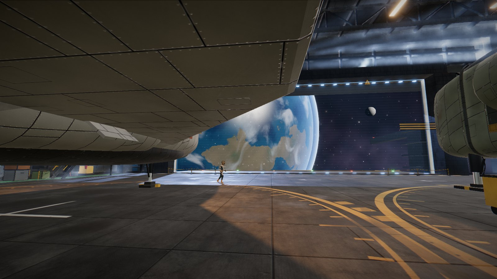

# Sillage — Hangar 07, station Halden-7

Démo jouable dans le navigateur (Three.js + Vite) : un grand hangar d'atterrissage de station
orbitale, relié par un sas à une galerie marchande, avec une baie donnant sur une planète.
Univers original, ressources CC0 ou créées pour le projet (voir [CREDITS.md](CREDITS.md)).


| | |
|---|---|
|  |  |
|  |  |

## Lancer la démo

Prérequis : Node.js 20 ou plus récent.

```bash
npm install
npm run dev          # http://localhost:5173 (et l'adresse réseau locale pour tester sur téléphone)
```

Version de production :

```bash
npm run build        # génère dist/
npm run preview      # sert dist/ sur http://localhost:4173
```

Pour tester sur un téléphone pendant le développement : `npm run dev`, puis ouvrir l'adresse
« Network » affichée par Vite depuis le téléphone (même réseau Wi-Fi).

## Commandes

| Action | Clavier / souris | Tactile |
|---|---|---|
| Se déplacer | ZQSD (AZERTY) ou WASD (QWERTY), flèches | joystick gauche |
| Regarder | souris (clic pour capturer le pointeur) | glisser sur la droite de l'écran |
| Courir | Maj | bouton COURIR (bascule) |
| Vue 1re / 3e personne | V | bouton VUE |
| Interagir (siège pilote, café, kiosque) | E | bouton E |
| Inventaire (personnage, Héron, sac) | I | bouton SAC |
| Décoller (assis aux commandes) / atterrir près de l'aire 02 | Espace / L | bouton ⏻ |
| Vol : poussée, monter / descendre, roulis, postcombustion | ZQSD, Espace / C, Q / E, Maj | joystick, ▲ ▼ |
| Menu / qualité | Échap | bouton ≡ |

Le vaisseau du joueur (Héron, aire 02) s'ouvre par la rampe arrière : on monte à bord sans
chargement, on traverse la soute, on gravit les marches du cockpit et on s'assoit aux commandes (E).

## Missions de fret

Au **quai de fret** (zone jaune à gauche de la rampe du Héron), le **terminal des contrats** propose des offres :
- **Livraison** : les caisses apparaissent sur le quai ; on les porte (E) jusque dans la soute, où elles sont arrimées
  automatiquement sur la grille, puis on vole jusqu'à l'avant-poste et on livre (E une fois posé).
- **Collecte** : on se pose à l'avant-poste, on charge (E), on revient et on dépose chaque caisse sur le quai.
- **Conteneur** : la manutention charge un conteneur dans la soute (4 rangées libres nécessaires).

Trois avant-postes en orbite : **Relais Corvin** (dépôt), **Plateforme Ardent-3** (mine et raffinerie),
**Station agricole Lys** (serres). Un repère à l'écran indique la destination et la distance ; on s'y pose avec L
(ou ⏻) quand on est à moins de 22 m au-dessus de l'aire. Paiement à la livraison ; abandon : pénalité de 10 %.
Code : `src/game/cargo.js`, `src/game/missions.js`, `src/world/outposts.js`.

## Minage et raffinage

1. Achetez un **laser de minage** à l'Équipement naval (ML-1 « Pic » ou ML-2 « Foreuse ») : il s'installe sous le nez du Héron.
2. Volez jusqu'au **champ d'astéroïdes** (Ceinture d'Ardent, repère à l'écran), puis **M** (bouton MIN) : mode minage,
   vitesse réduite, caméra relevée. Le panneau affiche la composition de la roche visée (fer, cuivre, titane,
   corindon, aurélite, part inerte), sa résistance et son instabilité.
3. **Clic gauche / X** (bouton LASER maintenu) : la charge monte ; gardez-la dans la **zone verte** pendant 3 s pour
   fracturer la roche ; au-delà de la zone rouge, surcharge : la roche est pulvérisée et perdue.
4. Visez les **fragments** et maintenez le laser à moins de 90 m pour extraire le minerai vers le bac (32 SCU ; la part inerte est rejetée).
5. Posez-vous à la **Plateforme Ardent-3** : *E — Opérations à quai* → **Raffinerie** (vente brute immédiate, ou
   raffinage Rapide / Standard / Précis : durée, rendement et frais différents) puis **Marché** (vente au cours du jour).
Code : `src/game/mining.js`.

## Équipage

Au **bureau de recrutement** de la galerie (Guilde des équipages, extrémité est, côté baie), on engage
jusqu'à 6 personnes parmi les candidats qui attendent sur place (frais d'embauche + salaire versé à chaque contrat) :
- **Manutentionnaire** : en ordre « Manutention du fret », il porte lui-même les caisses du quai jusqu'à la soute
  (livraisons) et de la soute jusqu'au quai (collectes) ;
- **Artilleur** : prend la tourelle dorsale en vol (la tourelle s'achète à l'Équipement naval) ;
- **Garde du corps** : vous suit partout ou garde la rampe.

Ordres : *Me suivre*, *Attendre ici*, *Manutention / Garder la rampe*. L'équipage embarque au décollage (sauf
« Attendre ici ») et redescend à l'atterrissage au hangar. Chaque membre s'équipe comme le joueur (tenue, armure,
armes) depuis l'inventaire ou directement en boutique (sélecteur « Pour »). Code : `src/game/crew.js`.

## Économie et boutiques

On démarre avec 15 000 ¤. Dans la galerie, chaque vendeur ouvre sa boutique (E au comptoir) :
**Armurerie Kestrel** (armes de poing et armes principales), **Combinaisons Vega** (tenues et armures),
**Équipement naval** (canons, lance-missiles, tourelle, bouclier du Héron), **Pharmacie** et **Nouilles Orbitales**.
On achète, revend (50 % du prix) et équipe ; la tenue, l'armure et les armes rangées se voient sur le personnage,
l'armement installé se voit sur le Héron (installation seulement vaisseau posé). La partie est sauvegardée
dans le navigateur (`localStorage`). Code : `src/game/` (catalogue, état, armement du vaisseau) et `src/ui/shop.js`.

## Qualité

Le menu propose 4 niveaux (mémorisés dans le navigateur) ; on peut aussi forcer `?quality=low|medium|high|ultra`.
Par défaut : *Basse* sur écran tactile, *Haute* sur ordinateur.

| | Basse (mobile) | Moyenne | Haute | Ultra |
|---|---|---|---|---|
| Résolution max | 1280×720 | 1600×900 | 2560×1440 | 3840×2160 |
| Ombres | soleil statique 1024 | 2048, à mi-cadence | 4096 + 2 projecteurs | 4096 + 4 projecteurs |
| Occlusion ambiante (N8AO) | non | demi-résolution | demi-résolution | pleine |
| Personnages | 18 | 28 | 40 | 52 |

## Mise en ligne

- **Artifact claude.ai** : `npm run build:artifact` produit `dist-artifact/`, où les .glb/.exr sont livrés
  en base64 (.b64.txt), car ce type d'hébergement ne sert que des formats web standard.

Le build est statique (dossier `dist/`, chemins relatifs) : il se dépose tel quel sur n'importe quel
hébergement de fichiers.

- **GitHub Pages** (inclus) : le workflow `.github/workflows/deploy-pages.yml` construit et publie
  à chaque push sur `main`. À activer une fois : *Settings → Pages → Source : GitHub Actions*.
  L'adresse sera `https://<utilisateur>.github.io/<dépôt>/`.
- **Netlify / Vercel / Cloudflare Pages** : commande de build `npm run build`, dossier publié `dist`.
- **itch.io** : `npm run build`, zipper le contenu de `dist/`, créer un projet « HTML » et cocher
  « This file will be played in the browser ».

Le site doit être servi en HTTPS pour le son et le verrouillage du pointeur (c'est le cas de tous
les hébergeurs ci-dessus).

## Organisation du code

```
src/main.js              démarrage, boucle, interactions, menu
src/core/                rendu (post-traitement ACES, bloom, AO, SMAA), qualité, entrées
src/world/               hangar, sas et galerie, vaisseaux, accessoires, matériaux et usure,
                         ciel et planète, éclairage, faisceaux et poussière, signalétique
src/characters/          personnages (Universal Base Characters), tenues en shader, reciblage des animations, regard
src/ai/                  grille de navigation, agents, rôles et emplois du temps, scènes de travail
src/vehicles/            chariot élévateur, tracteur + remorque, nacelle, chariot citerne
src/player/              contrôleur capsule (three-mesh-bvh), caméras
src/audio/               ambiance, annonces, machines, pas, conversations, musique (synthèse)
tools/                   génération des textures, préparation des assets, captures et tests
```

Outils de vérification (Playwright requis) :

```bash
node tools/screenshots.mjs http://localhost:5173/ overview,gallery high shots   # captures de revue
node tools/playtest.mjs   http://localhost:5173/ shots                          # test de jouabilité
node tools/perf.mjs       http://localhost:5173/ low,high                        # coût CPU / appels de rendu
```

Régénérer les textures procédurales : `python3 tools/gen_textures.py public/assets/textures/gen`
(Python 3 + numpy + Pillow).
