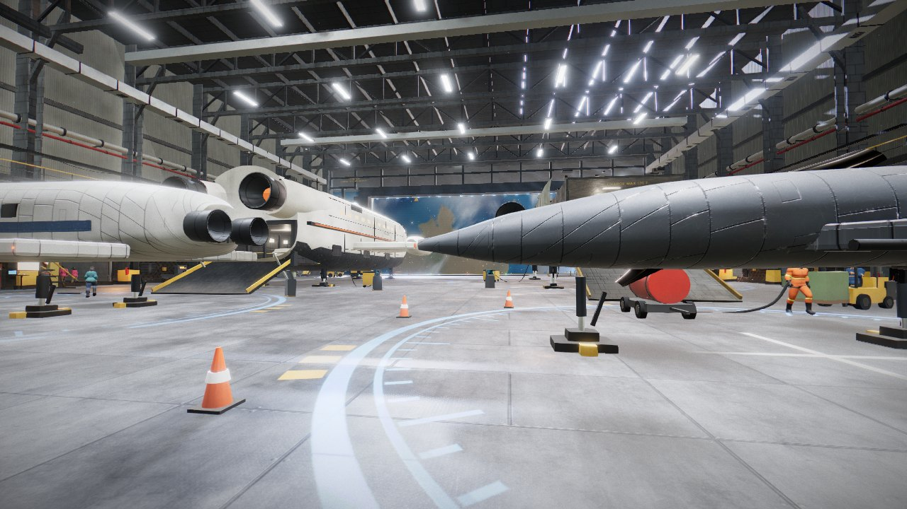
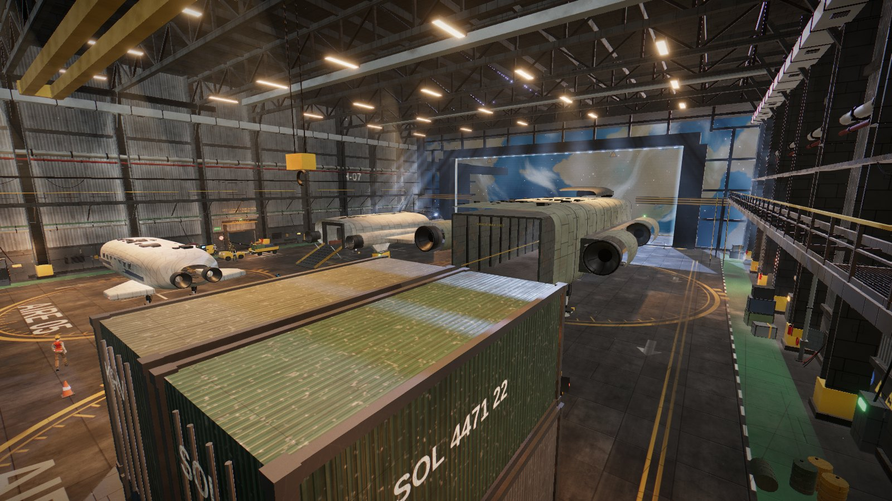
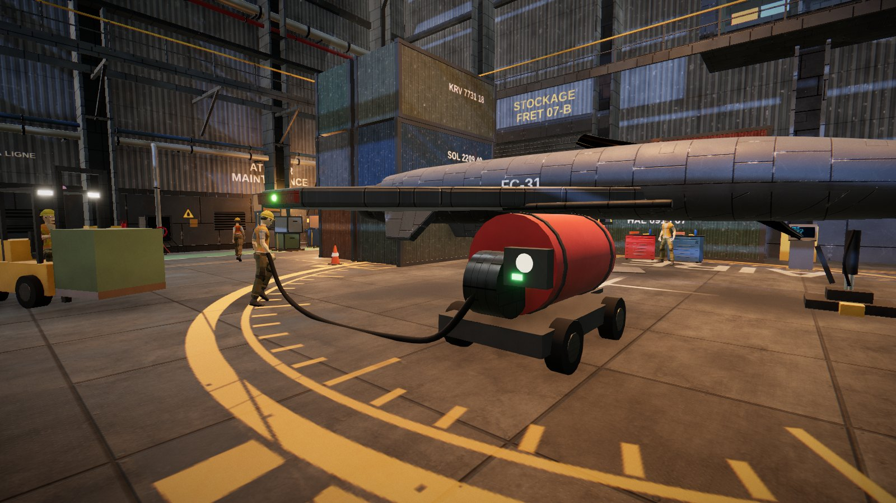

# Sillage — Hangar 07, station Halden-7

Jeu jouable dans le navigateur (Three.js + Vite) : un grand hangar d'atterrissage de station
orbitale, relié par un sas à une galerie marchande, avec une baie donnant sur une planète.
Univers original, ressources CC0 ou créées pour le projet (voir [CREDITS.md](CREDITS.md)).



| | |
|---|---|
|  |  |
|  |  |

## Lancer la démo

Prérequis : Node.js 20 ou plus récent.

```bash
npm install
npm run dev          # http://localhost:5173 (et l'adresse réseau locale pour tester sur téléphone)
```

Version de production :

```bash
npm run build        # génère dist/
npm run preview      # sert dist/ sur http://localhost:4173
```

Pour tester sur un téléphone pendant le développement : `npm run dev`, puis ouvrir l'adresse
« Network » affichée par Vite depuis le téléphone (même réseau Wi-Fi).

## Commandes

| Action | Clavier / souris | Tactile |
|---|---|---|
| Se déplacer | ZQSD (AZERTY) ou WASD (QWERTY), flèches | joystick gauche |
| Regarder | souris (clic pour capturer le pointeur) | glisser sur la droite de l'écran |
| Courir | Maj | bouton COURIR (bascule) |
| Vue 1re / 3e personne | V | bouton VUE |
| Interagir (siège pilote, café, kiosque) | E | bouton E |
| Inventaire (personnage, Héron, sac) | I | bouton SAC |
| Décoller (assis aux commandes) / atterrir près de l'aire 02 | Espace / L | bouton ⏻ |
| Vol : poussée, monter / descendre, roulis, postcombustion | ZQSD, Espace / C, Q / E, Maj | joystick, ▲ ▼ |
| Tirer (canons, ou laser de minage en mode minage) | clic gauche / X | bouton TIR (maintenir) |
| Missile (après 3 s de verrouillage) / cible suivante | R / T | bouton MSL |
| Mode minage | M | bouton MIN |
| À pied sur un avant-poste : descendre armé / dégainer, recharger, changer d'arme, soin | G, R, T, H | ARME, MSL, —, SOIN |
| Menu / qualité | Échap | bouton ≡ |

Le vaisseau du joueur (Héron, aire 02) s'ouvre par la rampe arrière : on monte à bord sans
chargement, on traverse la soute, on gravit les marches du cockpit et on s'assoit aux commandes (E).

## Missions de fret

Au **quai de fret** (zone jaune à gauche de la rampe du Héron), le **terminal des contrats** propose des offres :
- **Livraison** : les caisses apparaissent sur le quai ; on les porte (E) jusque dans la soute, où elles sont arrimées
  automatiquement sur la grille, puis on vole jusqu'à l'avant-poste et on livre (E une fois posé).
- **Collecte** : on se pose à l'avant-poste, on charge (E), on revient et on dépose chaque caisse sur le quai.
- **Conteneur** : la manutention charge un conteneur dans la soute (4 rangées libres nécessaires).

Trois avant-postes en orbite : **Relais Corvin** (dépôt), **Plateforme Ardent-3** (mine et raffinerie),
**Station agricole Lys** (serres). Un repère à l'écran indique la destination et la distance ; on s'y pose avec L
(ou ⏻) quand on est à moins de 22 m au-dessus de l'aire. Paiement à la livraison ; abandon : pénalité de 10 %.
Code : `src/game/cargo.js`, `src/game/missions.js`, `src/world/outposts.js`.

## Minage et raffinage

1. Achetez un **laser de minage** à l'Équipement naval (ML-1 « Pic » ou ML-2 « Foreuse ») : il s'installe sous le nez du Héron.
2. Volez jusqu'au **champ d'astéroïdes** (Ceinture d'Ardent, repère à l'écran), puis **M** (bouton MIN) : mode minage,
   vitesse réduite, caméra relevée. Le panneau affiche la composition de la roche visée (fer, cuivre, titane,
   corindon, aurélite, part inerte), sa résistance et son instabilité.
3. **Clic gauche / X** (bouton LASER maintenu) : la charge monte ; gardez-la dans la **zone verte** pendant 3 s pour
   fracturer la roche ; au-delà de la zone rouge, surcharge : la roche est pulvérisée et perdue.
4. Visez les **fragments** et maintenez le laser à moins de 90 m pour extraire le minerai vers le bac (32 SCU ; la part inerte est rejetée).
5. Posez-vous à la **Plateforme Ardent-3** : *E — Opérations à quai* → **Raffinerie** (vente brute immédiate, ou
   raffinage Rapide / Standard / Précis : durée, rendement et frais différents) puis **Marché** (vente au cours du jour).
Code : `src/game/mining.js`.

## Combat spatial

À plus de 1,5 km de Halden-7, l'espace n'est plus surveillé : des chasseurs pirates interceptent le
Héron pendant les trajets et dans la Ceinture d'Ardent (vagues plus grosses quand la soute est pleine
ou en plein minage). Deux modèles : l'Écorcheur, léger et vif, et le Charognard, plus lourd et
mieux protégé. Ils attaquent en passes successives (approche en tire-bouchon, tir anticipé, dégagement)
et décrochent si vous revenez dans la zone protégée de la station (1,1 km, armes verrouillées).

- **Armes du Héron** : celles installées à l'Équipement naval tirent depuis leur emplacement réel.
  Laser (énergie, illimité), balistique (600 obus, 40 % des dégâts traversent les boucliers),
  lance-missiles (4 missiles à guidage, verrouillage en gardant la cible 3 s dans l'axe).
  Un cercle jaune indique le point de tir anticipé ; les tirs proches de l'axe sont corrigés vers lui.
- **Tourelle dorsale** : servie automatiquement par l'artilleur recruté s'il est à bord.
- **Boucliers et coque** : le bouclier encaisse d'abord et se recharge après quelques secondes sans
  impact (S1 : 2 400, S2 : 5 200). La coque est conservée d'un vol à l'autre ; réparations et réarmement
  sont facturés à l'atterrissage.
- **Primes** : chaque pirate abattu rapporte 900 à 2 800 ¤.
- **Destruction** : capsule de survie, Héron remplacé à l'aire 02, franchise d'assurance
  (2 500 ¤ + 5 % des crédits) et perte du minerai.
- **Interface** : barres bouclier / coque, armement, cadre de cible (bouclier, coque, distance),
  repères des autres hostiles, radar de 2,5 km (station en vert).

## Combat à pied (avant-postes)

Les avant-postes ont désormais un pont de débarquement entre l'aire et la tour, avec des caisses
qui servent de couverture. Le Héron s'y pose rampe face au pont.

- **Raids** : à l'atterrissage sur un avant-poste, un raid pirate peut être en cours (3 chances sur 10,
  ou à coup sûr avec un contrat « Sécurité » du terminal des contrats). Les pirates sortent de la tour,
  prennent position derrière les caisses, tirent en rafales, s'accroupissent et rechargent.
- **Descendre armé** : posé sur l'avant-poste, **G** (bouton ARME) fait descendre par la rampe ;
  l'arme est dégainée automatiquement pendant un raid. **E** à la rampe pour remonter à bord.
- **Armes personnelles** : celles de l'Armurerie Kestrel (dégâts, cadence, portée, chargeur, dispersion
  propres à chaque arme ; tir réel au centre de l'écran, tête ×2). **R** recharger, **T** passer de
  l'arme principale à l'arme de poing, **H** stylo médical (+55 santé). Armes interdites dans la station.
- **Gardes** : les gardes de l'équipage à bord descendent avec vous, avec l'arme et l'armure que vous
  leur avez achetées, prennent les caisses côté vaisseau et combattent. Un garde blessé reste à terre
  jusqu'à la fin du raid.
- **Armure** : réduit les dégâts reçus (légère 20 %, moyenne 40 %, lourde 65 %).
- **Récompenses** : 420 à 720 ¤ par pirate, puis le contrat de sécurité ou une prime de 1 500 ¤.
- **À terre** : évacuation à bord, soins d'urgence (1 200 ¤), le raid échoue (le contrat reste ouvert).

## Cour des Saveurs (restauration)

Sur le pont habitat, le couloir nord du hall des ascenseurs mène à une grande salle de restauration
(70 × 40 m, verrière sur l'espace, fontaine holographique, arbres, tables et tables hautes). Dix restaurants,
chacun avec son enseigne, son menu lumineux, sa cuisine équipée et ses horaires : Dragon de Jade (chinois),
Cantina Sol (mexicain), Fournil d'Orbite (boulangerie), Taqueria Cometa (tacos), Masala Station (indien),
Sushi Orbital, Grill 66 (burgers), Pizzeria Vesuvio, Café Nébula, Phở Lune Rousse (vietnamien).
E au comptoir : la carte du restaurant (chaque plat rend un peu de santé). Les cuisiniers passent du fourneau
au comptoir, des clients mangent attablés, d'autres commandent puis mangent debout. Borne-plan à l'entrée.

Détail : plats modélisés (bols de phở et de ramen, makis et nigiris sur tapis roulant, pizzas, burgers, tacos,
croissants et baguettes, raviolis vapeur, currys), woks, marmites, paniers vapeur, canards laqués, four à pizza,
frigos vitrés garnis, rails d'ustensiles, menus illustrés, chevalets ardoise, plateaux servis sur les tables,
condiments et serviettes, stations de tri, affiches, bannières suspendues, gaines de ventilation, robot de
nettoyage, vapeur et flammes en cuisine, ambiance sonore (brouhaha, friture, vaisselle). Les figurants du pont
sont solides (on ne les traverse plus). Performances : figurants du pont sans ombre portée, animation figée
au-delà de 38 m, vaisselle fusionnée en géométrie statique.

Mobilier de station : sièges coque en composite sur pied pivotant, tables à liseré lumineux, suspensions annulaires
à LED, banquettes, bacs hydroponiques éclairés, sol en résine polie à panneaux. Aliments et plantes photoscannés
(Poly Haven, CC0) : croissants, gâteaux, pains à burger, agrumes, avocats, oignons, gingembre, fruits, bouteilles, cagettes.
Les plats cuisinés ont des textures alimentaires (croûte dorée, fromage gratiné, riz, saumon, bouillon, curry…).

**Vie des clients** : ils arrivent de la galerie par l'**ascenseur** (appel au palier, attente, embarquement, trajet,
sortie), font la queue au restaurant choisi, commandent, reçoivent leur plateau (plat selon la cuisine), le portent
à deux mains jusqu'à une place libre, s'assoient et **mangent** (bouchées portées à la bouche avec baguettes, fourchette,
cuillère ou à la main, mastication, pauses conversation ; le plat diminue), puis rapportent le plateau au point de tri
et redescendent à la galerie. Le cuisinier vient servir quand un client attend.

## Vie de la station (horaires)

Horloge accélérée (1 s réelle = 48 s à bord ; une journée = 30 min de jeu), affichée en haut à droite.
Horaires des boutiques : Nouilles 7 h–24 h, Armurerie 9 h–21 h, Équipement naval 8 h–20 h,
Combinaisons 10 h–21 h, Pharmacie 24 h/24. À la fermeture, le rideau de fer descend et le vendeur rentre
au module habitat ; il revient à l'ouverture. La galerie se vide la nuit (23 h–7 h), les navettes se font rares,
l'éclairage baisse. Dormir dans la cabine 12 le soir fait passer au matin (07:00).

Hangar : terminal de diagnostic du Héron (près de l'aire 02), casiers du personnel (inventaire),
panneau d'annonces, racks de pièces et fûts. Galerie : distributeurs, borne-plan, bancs et chaises où
s'asseoir (E). Les vendeurs restent derrière leur comptoir, rangent l'étagère du fond, se tournent vers les
clients et vous saluent quand vous entrez.

## Module habitat

Au fond de la galerie marchande, la porte « MODULE HABITAT » mène par un couloir au hall des ascenseurs.
Les deux cabines circulent réellement dans leur gaine : appelez-les au palier (E), entrez, puis E pour monter au **pont habitat** (environ 8 s de trajet, repères lumineux qui défilent ; les portes palières ne s'ouvrent que si la cabine est à l'étage) : promenade avec baie vitrée sur la planète,
**bar La Comète** (boissons à 8 ¤ et rumeurs utiles), **infirmerie** (soins complets à 250 ¤, un stylo
médical offert) et **cabine 12** du joueur (repos : santé au maximum et sauvegarde). Le long du mur nord, les autres cabines numérotées affichent libre / occupée. Sur le pont, un serveur fait sa tournée, un couple se promène le long de la baie, un résident rentre chez lui.

## Alerte d'intrusion (hangar 07)

De temps en temps (première alerte après 5 à 8 minutes à pied dans le hangar), des pirates franchissent
le champ de confinement de la baie. Le port d'arme est alors autorisé (**G**) ; trois agents de la sécurité
de la station et vos gardes (s'ils vous suivent) prennent position derrière les caisses de transit devant
la baie, les civils s'accroupissent à l'abri. Prime de la sécurité : 2 000 ¤ en plus des primes par pirate.
À terre : infirmerie de la station (1 200 ¤), la sécurité termine le travail.

## Commerce des matériaux

Les matériaux raffinés récupérés à Ardent-3 sont chargés dans la soute du Héron et se revendent sur trois
marchés : Ardent-3 (rachat au rabais), Relais Corvin (métaux de construction : fer, cuivre) et Station
agricole Lys (titane, corindon, aurélite). L'onglet « Marché des matériaux » de chaque avant-poste compare
les cours, et le repère de navigation indique le marché le plus rentable pour votre chargement.

## Abordage

Certaines vagues pirates escortent un **cargo Rançonneur** qui tente de fuir (il s'échappe au-delà de
3,6 km). Abattez ses boucliers puis sa coque sous 30 % : il est **désemparé** (moteurs coupés, étincelles).
Après avoir éliminé les escortes, approchez à moins de 150 m en ralentissant puis **E / B** : le Héron
s'arrime à son flanc et vous passez le sas, avec vos gardes. La soute est défendue par 4 à 5 pirates ;
une fois saisie, deux caisses de contrebande attendent près de la porte du fond (1 400 à 3 000 ¤ chacune).
Remontez par le sas (**E**), puis **Espace** pour vous désarrimer : le cargo se saborde derrière vous.

## Équipage à bord

L'équipage embarqué est visible à son poste dans le Héron et suit le vaisseau en vol : l'artilleur au
siège du copilote (tourelle télé-opérée), le garde en haut de la rampe, les autres dans la soute et sur
le pont supérieur. Les gardes qui descendent combattre quittent leur poste et le reprennent au retour.

## Équipage

Au **bureau de recrutement** de la galerie (Guilde des équipages, extrémité est, côté baie), on engage
jusqu'à 6 personnes parmi les candidats qui attendent sur place (frais d'embauche + salaire versé à chaque contrat) :
- **Manutentionnaire** : en ordre « Manutention du fret », il porte lui-même les caisses du quai jusqu'à la soute
  (livraisons) et de la soute jusqu'au quai (collectes) ;
- **Artilleur** : prend la tourelle dorsale en vol (la tourelle s'achète à l'Équipement naval) ;
- **Garde du corps** : vous suit partout ou garde la rampe.

Ordres : *Me suivre*, *Attendre ici*, *Manutention / Garder la rampe*. L'équipage embarque au décollage (sauf
« Attendre ici ») et redescend à l'atterrissage au hangar. Chaque membre s'équipe comme le joueur (tenue, armure,
armes) depuis l'inventaire ou directement en boutique (sélecteur « Pour »). Code : `src/game/crew.js`.

## Économie et boutiques

On démarre avec 15 000 ¤. Dans la galerie, chaque vendeur ouvre sa boutique (E au comptoir) :
**Armurerie Kestrel** (armes de poing et armes principales), **Combinaisons Vega** (tenues et armures),
**Équipement naval** (canons, lance-missiles, tourelle, bouclier du Héron), **Pharmacie** et **Nouilles Orbitales**.
On achète, revend (50 % du prix) et équipe ; la tenue, l'armure et les armes rangées se voient sur le personnage,
l'armement installé se voit sur le Héron (installation seulement vaisseau posé). La partie est sauvegardée
dans le navigateur (`localStorage`). Code : `src/game/` (catalogue, état, armement du vaisseau) et `src/ui/shop.js`.

## Qualité

Le menu propose 4 niveaux (mémorisés dans le navigateur) ; on peut aussi forcer `?quality=low|medium|high|ultra`.
Par défaut : *Basse* sur écran tactile, *Haute* sur ordinateur.

| | Basse (mobile) | Moyenne | Haute | Ultra |
|---|---|---|---|---|
| Résolution max | 1280×720 | 1600×900 | 2560×1440 | 3840×2160 |
| Ombres | soleil statique 1024 | 2048, à mi-cadence | 4096 + 2 projecteurs | 4096 + 4 projecteurs |
| Occlusion ambiante (N8AO) | non | demi-résolution | demi-résolution | pleine |
| Personnages | 18 | 28 | 40 | 52 |

## Mise en ligne

- **Artifact claude.ai** : `npm run build:artifact` produit `dist-artifact/`, où les .glb/.exr sont livrés
  en base64 (.b64.txt), car ce type d'hébergement ne sert que des formats web standard.

Le build est statique (dossier `dist/`, chemins relatifs) : il se dépose tel quel sur n'importe quel
hébergement de fichiers.

- **GitHub Pages** (inclus) : le workflow `.github/workflows/deploy-pages.yml` construit et publie
  à chaque push sur `main`. À activer une fois : *Settings → Pages → Source : GitHub Actions*.
  L'adresse sera `https://<utilisateur>.github.io/<dépôt>/`.
- **Netlify / Vercel / Cloudflare Pages** : commande de build `npm run build`, dossier publié `dist`.
- **itch.io** : `npm run build`, zipper le contenu de `dist/`, créer un projet « HTML » et cocher
  « This file will be played in the browser ».

Le site doit être servi en HTTPS pour le son et le verrouillage du pointeur (c'est le cas de tous
les hébergeurs ci-dessus).

## Organisation du code

```
src/main.js              démarrage, boucle, interactions, menu
src/core/                rendu (post-traitement ACES, bloom, AO, SMAA), qualité, entrées
src/world/               hangar, sas et galerie, vaisseaux, accessoires, matériaux et usure,
                         ciel et planète, éclairage, faisceaux et poussière, signalétique
src/characters/          personnages (Universal Base Characters), tenues en shader, reciblage des animations, regard
src/ai/                  grille de navigation, agents, rôles et emplois du temps, scènes de travail
src/vehicles/            chariot élévateur, tracteur + remorque, nacelle, chariot citerne
src/player/              contrôleur capsule (three-mesh-bvh), caméras
src/game/                 économie, catalogue, fret, équipage, minage, combat spatial
src/audio/               ambiance, annonces, machines, pas, conversations, musique (synthèse)
tools/                   génération des textures, préparation des assets, captures et tests
```

Outils de vérification (Playwright requis) :

```bash
node tools/screenshots.mjs http://localhost:5173/ overview,gallery high shots   # captures de revue
node tools/playtest.mjs   http://localhost:5173/ shots                          # test de jouabilité
node tools/perf.mjs       http://localhost:5173/ low,high                        # coût CPU / appels de rendu
```

Régénérer les textures procédurales : `python3 tools/gen_textures.py public/assets/textures/gen`
(Python 3 + numpy + Pillow).
